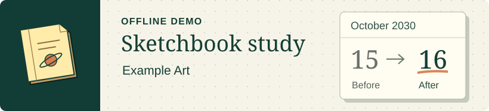

# Jupiter Ed Student Sync

[中文安装指南](docs/INSTALL.zh-CN.md) · [English guide](docs/README.en.md) · [支持范围](docs/SUPPORT.zh-CN.md)

把自己的 Jupiter 课程、作业和校历保存在自己的 GitHub 私有仓库。每次读取后，你可以看到新增了哪些记录、哪项作业改了日期，或某一天学校发布了什么公告。GitHub 运行页面显示统计，课程与公告明细保存在加密快照中。



## 先看作业改期和校历公告

在装有 **Node.js 24** 的电脑上下载并解压本项目，在含有 `package.json` 的目录运行下面这条命令。演示使用两门虚构课程，无需账号、浏览器或安装依赖。

```sh
npm run demo
```

| 演示中的读取 | 你会看到什么 |
| --- | --- |
| 第一次读取 | 发现两条作业。数学作业只写了 `10/12`，程序保留原文，完整截止日期显示为未知。 |
| 美术作业改期 | 日期从 `2030-10-15` 变为 `2030-10-16`，同一条作业记为「已变更」。 |
| 再读相同内容 | 0 新增、0 变化、2 条不变。 |

演示还会列出两天的虚构校历公告。比如 2030 年 10 月 3 日的集会，日期有出处，开始时间显示为未知。

## 读取自己的账号

1. 在仓库顶部选 **Use this template → Create a new repository**，为自己的副本选择 **Private**。
2. 在自己的副本里填入 [5 个 GitHub Secrets](docs/SECRETS.zh-CN.md)，包括自己的账号、学校配置和专属加密密钥。请将密钥另存到密码管理器。
3. 打开 **Actions → Student read → Run workflow**，选择 `initialize` 并勾选初始化确认。完成后在 **Summary** 找到 **Snapshot verified**，核对课程数与作业数。
4. 如需校历，在仓库 **Variables** 中设置 `CALENDAR_READ_ENABLED=true`。校历在下次允许采集时生效。首次读取核对成功后，可用 `SYNC_ENABLED=true` 开启定时采集。

[跟着中文指南完成首次读取、查看明细和处理常见问题 →](docs/INSTALL.zh-CN.md)

## 快照里有什么

| 来源 | 保存的内容 | 应该怎样理解 |
| --- | --- | --- |
| 课程与作业 | 课程、作业名称、原始成绩、分类、日期文本和跨次变化 | 已评分和已完成是两件事。缺少年份或时间时保留未知。 |
| 学校 Calendar（可选） | 已核验月份中的日历记录、与作业的关联，以及按日期整理的公告原文 | 某天有公告只证明这一天出现了这条信息。钟点、节次及作业截止时间都需要单独的来源证据。 |
| 本地导出 | 在自己的设备解密为 JSON，可另行生成 TickTick 预览文件 | 当前公开版提供只读采集与加密存档。TickTick 自动写入和 AI 学习规划不在本版范围内。 |

定时读取由 GitHub 执行，电脑可以关机。窗口使用你配置的时区，实际采集时间以运行结果为准。需要额外调度保障时，可选配 [Cloudflare](optional/cloudflare/README.md)。

**验证进度。** 公开版提供使用虚构数据的测试与离线浏览器验证。独立学生账号的首次真实部署及其学校的 Calendar 兼容性仍待验证。第一次读取后，请对照自己的 Jupiter 页面核查覆盖范围。[支持与限制](docs/SUPPORT.zh-CN.md)

**隐私与许可。** 这是非官方第三方工具，与 Jupiter Ed 无隶属关系。只使用你有权访问的账号，遵守学校规定和适用服务条款。密码、填好的配置、解密文件和学业数据应保存在自己控制的私有位置。项目采用 MIT 许可，包含 Taj Jethwani-Keyser 的 `jupiter-api` 改编代码。[安全审计](docs/SECURITY-AUDIT.md) · [许可证](LICENSE) · [原作者署名](NOTICE.md)
